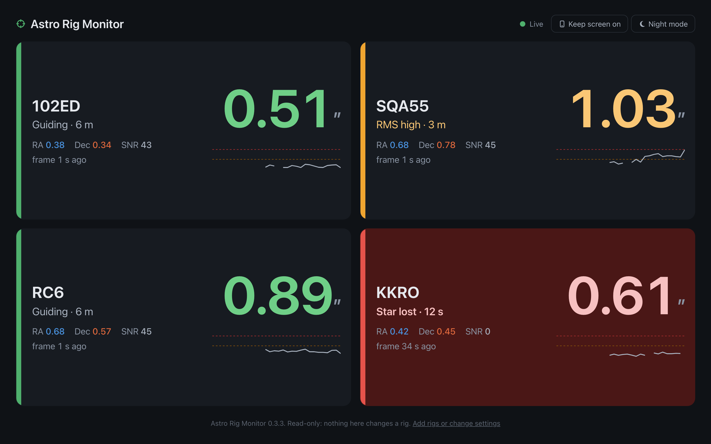
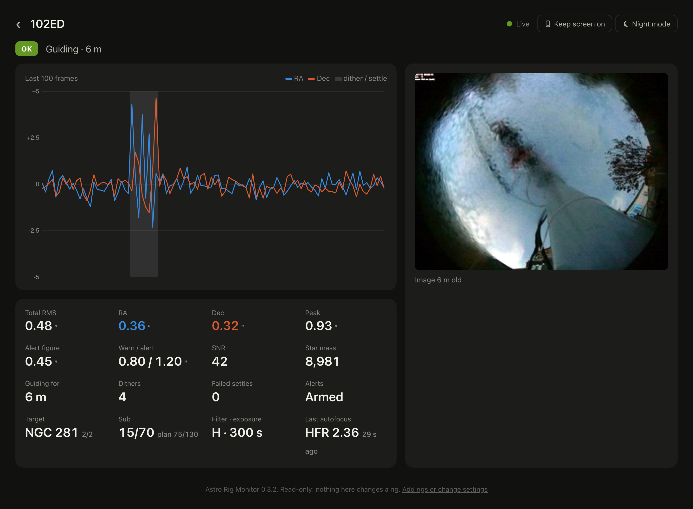
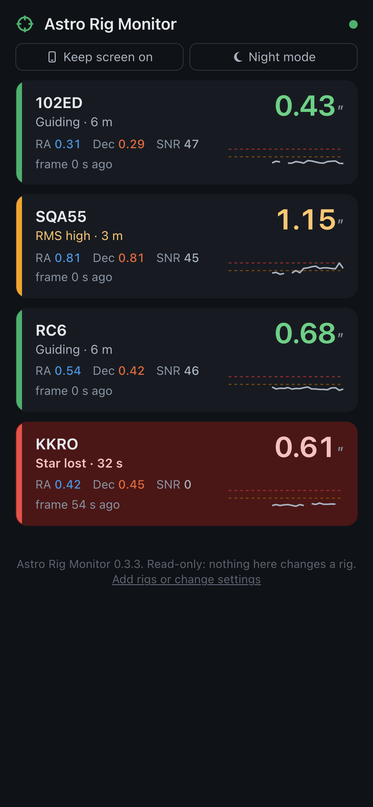
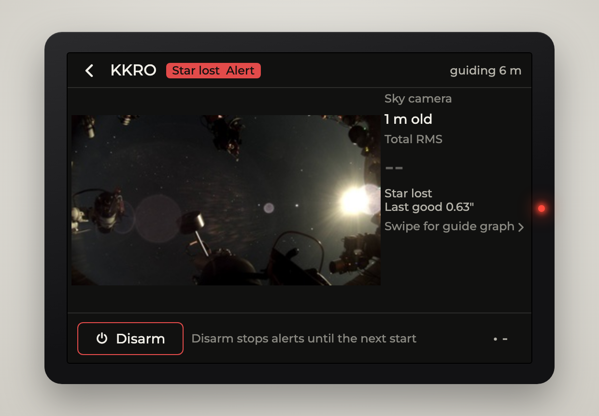

# Astro Rig Monitor

Keeps an eye on your telescope's autoguiding so you don't have to. It reads the guiding of every rig on your network from an **ASIAIR** or **PHD2** (including PHD2 driven by **N.I.N.A.**), and tells you only when something goes wrong: RMS creeping up, star lost, guiding stopped and not resumed, a rig gone offline. A tracker without guiding can be watched too, from its controller's status page: frames, star size and count, cloud and focus warnings ([details](docs/configuration.md#trackers-without-guiding)).

- **Web page** for your phone, tablet or desktop: every rig at a glance, a detail view with the guide graph, and a night-mode red screen.
- **Phone alerts** through the free [ntfy](https://ntfy.sh) app or a Discord channel.
- **Night reports:** each morning, a one-page summary of last night's guiding per rig: RMS through the night, alerts, dithers, and why the plan paused (meridian flip, new target, autofocus, cloud).
- **Build your own display:** a tablet or Raspberry Pi screen in kiosk mode, your own web page, a desktop window, an ESP32 with LEDs, or Home Assistant. A [step-by-step guide](docs/build-a-display.md) and working examples are included.

**Project page:** [dgsgc.github.io/astro-rig-monitor](https://dgsgc.github.io/astro-rig-monitor/), with screenshots, downloads and a quick start.

**Install it in a few minutes:** [Mac app](#mac) · [Windows app](#windows) · [Raspberry Pi or Linux](#raspberry-pi-and-linux). No programming needed.

**It is read-only.** It only listens to the guiding events the ASIAIR or PHD2 already broadcast on port 4400. It never sends a command to a rig, so it can't disturb a running session. ASIAIR users can optionally let it listen to the app's own port too, for autofocus, filter changes and plan progress ([details](docs/configuration.md#the-asiair-app-port-optional); unofficial, so a future firmware could change it).

## Screenshots

These are from a demo night with four rigs: two guiding well (green), one with RMS creeping up (amber, WARNING) and one that has lost its guide star (red, ALERT).

**Desktop.** Every rig at a glance, with total RMS, RA/Dec and a 10-minute trend against the warn and alert levels:



The detail page has the last 100 frames (dithers shaded), the stats, and the all-sky camera if you have one. ASIAIR rigs that use the optional app port also show the target, sub count, filter and last autofocus:



**Phone.** The overview, a rig in ALERT, and a rig in WARNING:

<p>



</p>

**Desk display (optional, over MQTT).** An ESP32 touch-screen display; its firmware is in [`esp32/`](esp32/README.md), ready to build for a Guition JC3248W535 board. The images are mock-ups built from the display's own layout:
- The overview, with one row per rig. Its LED is off when everything's fine, solid on a warning and flashing on an alert.
- A rig's guide graph.
- The sky camera, which the display shows first when cloud could be the cause.

<p>



</p>

## What it alerts on

Each rig is **idle** until guiding starts, then **armed**:

| Level | When |
|---|---|
| OK | Guiding, total RMS below your WARN level |
| WARN | Total RMS above WARN for about 20 s |
| ALERT | RMS above ALERT for about 20 s; star lost or guiding stopped for more than 20 s, unless a plan task (goto, autofocus, flip) is under way; that task taking too long; settling failing repeatedly; the rig going offline or silent |

One bad frame never alerts, dithers and settling are left out of the alert figure, and the rig disarms itself when the plan finishes or the sun comes up, so a finished night doesn't alert all morning.

## What you need

- **A computer that stays on through the night,** on the same network as your rigs: a Mac, a Windows PC or a Raspberry Pi (or any Linux box). It uses very little power or CPU.
- **Rigs running an ASIAIR** (any model) **or PHD2** 2.6 or later (on its own or with N.I.N.A.). PHD2's event server must be on: *Tools → Enable Server*, on by default. Give each ASIAIR a fixed address on your router (a DHCP reservation).
- A remote observatory works too, over [Tailscale](https://tailscale.com) or another VPN. Don't open port 4400 to the internet.
- Optional: a tracker without guiding whose controller serves a JSON status page ([details](docs/configuration.md#trackers-without-guiding)), and an MQTT broker such as Mosquitto, only for a microcontroller display or Home Assistant.

## Install

Pick the computer that will run it. You don't need Python or a terminal on a Mac or Windows PC: the apps bring everything with them.

| Computer | Download |
|---|---|
| **Mac** (macOS 13 or later) | [Apple Silicon (M1 and later)](https://github.com/dgsgc/astro-rig-monitor/releases/download/mac-v0.1.3/Astro-Rig-Monitor-Apple-Silicon.zip) · [Intel](https://github.com/dgsgc/astro-rig-monitor/releases/download/mac-v0.1.3/Astro-Rig-Monitor-Intel.zip) |
| **Windows** 10 or 11 (64-bit) | [Astro-Rig-Monitor-Setup.exe](https://github.com/dgsgc/astro-rig-monitor/releases/download/win-v0.1.2/Astro-Rig-Monitor-Setup.exe) |
| **Raspberry Pi** or Linux | one command, below |

Each way runs the same monitor, with the same settings file, web page, alerts and reports.

### Mac

1. **Download** the zip for your Mac. Not sure which? Apple menu → About This Mac: "Chip: Apple M…" is Apple Silicon, "Processor: … Intel" is Intel.
2. **Unzip it and drag Astro Rig Monitor into Applications.** The first time, right-click it and choose **Open**, then **Open** again (it isn't notarised by Apple).
3. **Set up:** the setup window opens by itself. Add your rigs and press **Save and start** ([details](#setting-up-your-rigs)). When macOS asks, allow the background item and access to your local network.

It lives in the menu bar (the crosshair icon), starts at login and keeps the Mac awake while it runs. **To update:** choose Quit in its menu, replace the app in Applications with the new one, and open it. More in [mac/README.md](mac/README.md).

### Windows

1. **Download and run** `Astro-Rig-Monitor-Setup.exe`. If Windows says *"Windows protected your PC"*, click **More info**, then **Run anyway** (it isn't signed with a paid certificate). It doesn't need administrator rights.
2. **Set up:** the setup window opens by itself. Add your rigs and press **Save and start** ([details](#setting-up-your-rigs)).
3. **Allow the firewall:** when Windows asks about `pythonw.exe`, allow it on **private networks**, so your phone can open the page.

It sits in the system tray by the clock, starts at login and keeps the PC awake while it runs. **To update:** run the new installer; your settings stay. More in [windows/README.md](windows/README.md).

### Raspberry Pi and Linux

For Raspberry Pi OS (Bookworm or later), Debian 12+ or Ubuntu 24.04+.

1. **Install:** paste this into a terminal on the Pi, as your normal user (it asks for your password once, to add the service):

   ```bash
   curl -fsSL https://raw.githubusercontent.com/dgsgc/astro-rig-monitor/main/tools/install.sh | bash
   ```

2. **Set up:** open the address it prints (`http://<the Pi's address>:8080/setup`) on your phone or computer. Add your rigs and press **Save and start** ([details](#setting-up-your-rigs)).

It runs as a service that starts at boot. **To update:** run the same command again; your settings stay. **To remove:** add ` -s -- --remove` after `bash`. The log is `~/astro-rig-monitor/arm.log`.

**Want to do it by hand instead?** See [Manual install (optional)](#manual-install-optional).

## Setting up your rigs

The setup page opens by itself the first time (on a Pi, open the address the installer printed). Add each rig, choose your alerts and press **Save and start**. Then open `http://<that computer's address>:8080` on your phone: the Mac and Windows apps' menus have **Open on Your Phone…** with a QR code. On an iPhone, *Share → Add to Home Screen* makes it open like an app.

- **Listen to detect:** for each rig, the page can listen to it for up to a minute to work out whether it's an ASIAIR or PHD2 and what units it reports. Do it while the rig is guiding and there's almost nothing to answer. It sends an ASIAIR nothing. PHD2 is asked one read-only question, its guide scale (`get_pixel_scale`), so you don't have to look it up; that's the only thing any part of the monitor ever sends to a rig, and the running monitor sends nothing.
- **Remote observatory:** use the PC's address on [Tailscale](https://tailscale.com) or another VPN. Never open port 4400 to the internet.
- **All-sky camera (optional):** paste the address of the camera's latest picture (on its web page, right-click the picture and Copy Image Address; a Dropbox share link works too, and the page makes it a direct link). **Check** fetches it once and shows how it will look. The next rig gets the same address, since rigs at one site share a sky.
- **Phone alerts:** the free [ntfy](https://ntfy.sh) app (the page makes a private topic and has a test button) and/or a Discord webhook.
- **Adding rigs later:** the web page has an **Add rigs or change settings** link at the bottom when you open it on the monitor's own computer (`http://localhost:8080`; in the Mac and Windows apps, **Add Rigs or Change Settings…**; a Pi set up from another computer allows it from your phone too). Adding a rig keeps everything already in the file; starting again keeps the old file as a backup. The monitor restarts itself with the new settings.
- **Settings the page doesn't cover** are in `config.toml` ([every setting](docs/configuration.md)). After editing it, restart the monitor (Mac and Windows apps: **More → Restart Monitor**; Raspberry Pi: `sudo systemctl restart astro-rig-monitor`; manual install: run the service installer again).

## Setting the levels

Total RMS in arcseconds, √(RA² + Dec²). A common starting point is WARN at about half your **imaging** pixel scale and ALERT at about 0.8×, then adjust after a night or two using the morning report. For example, at 1″/px imaging: `warn = 0.6`, `alert = 0.9`; at 3″/px: `warn = 1.0`, `alert = 1.5`.

The figure on the web page is meant to match what your ASIAIR or NINA shows; see [configuration](docs/configuration.md#matching-the-numbers-you-see) for the settings that control it.

## Manual install (optional)

You don't need this if you used an app or the Pi command above. It's for running from the source code, on any computer, by hand. Needs Python 3.11 or later and git.

```bash
git clone https://github.com/dgsgc/astro-rig-monitor.git
cd astro-rig-monitor
python3 -m venv .venv
.venv/bin/pip install -r requirements.txt          # Windows: .venv\Scripts\pip install -r requirements.txt
.venv/bin/python -m arm                        # first run: serves the setup page; Ctrl+C to stop
```

On Windows, use `.venv\Scripts\python` in place of `.venv/bin/python`. The first time, there's no `config.toml` yet, so the monitor serves the [setup page](#setting-up-your-rigs) at `http://localhost:8080/setup`. On a computer without a screen (a Raspberry Pi, say), run `.venv/bin/python -m arm --setup-from-lan` instead and open `http://<its address>:8080/setup` from another computer. Rather answer questions in the terminal? `.venv/bin/python -m arm setup` asks the same questions and writes `config.toml`.

**Run it in the background.** Once it's set up, stop it (Ctrl+C) and install it as a service that starts by itself and comes back after a reboot:

| System | Install / update | Remove |
|---|---|---|
| Raspberry Pi, Linux | `tools/install_service_linux.sh` | `tools/install_service_linux.sh --remove` |
| Windows (PowerShell, if not using the app) | `powershell -ExecutionPolicy Bypass -File tools\install_service_windows.ps1` | same with `-Remove` |
| macOS (if not using the app) | `tools/install_service_mac.sh` | `tools/install_service_mac.sh --remove` |

Each installer copies the program and your `config.toml` to `~/astro-rig-monitor` (Windows: `%USERPROFILE%\astro-rig-monitor`), makes its own Python environment there, and starts the service. Run it again after updating the code (`git pull`) or changing `config.toml`. The log is `arm.log` in that folder. To keep your `config.toml` somewhere else (say, a private folder or repo), add `--config <path>` (Windows: `-Config <path>`).

The service runs from its own copy of `config.toml`. Changes made on the setup page go into that copy, so if you keep the original elsewhere, copy them back before running the installer again (it overwrites the copy).

## Documentation

- [Configuration](docs/configuration.md): every setting, ASIAIR / PHD2 / NINA notes, alerts, night reports, the web page.
- [Build your own display](docs/build-a-display.md): kiosk screens, your own web page, a desktop window, ESP32 over MQTT, Home Assistant.
- [MQTT message spec](docs/mqtt-spec.md): every message and field, for displays and integrations.
- [Development](docs/development.md): tests, a fake rig for testing without a telescope, replaying a logged night.
- [Changes](CHANGELOG.md): what's new in each version, and how to upgrade.

## Licence

MIT. See [LICENSE](LICENSE).
