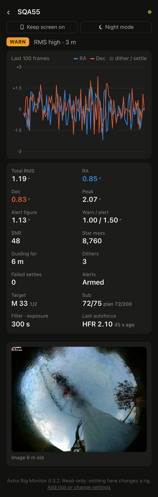
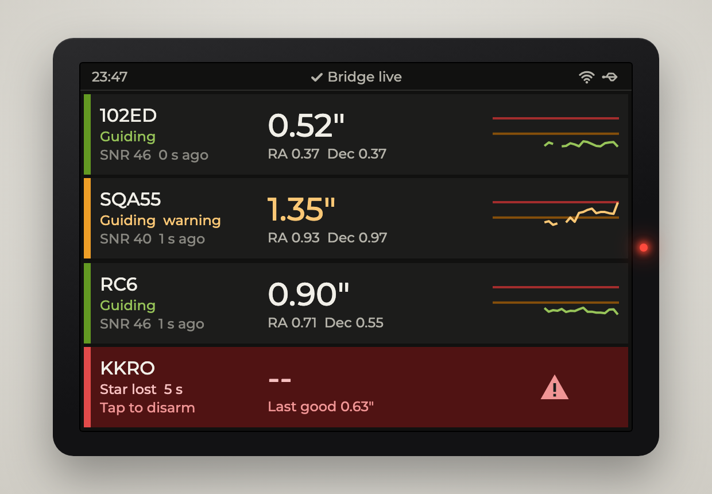

# Astro Rig Monitor

Keeps an eye on your telescope's autoguiding so you don't have to. It reads the guiding of every rig on your network from an **ASIAIR** or **PHD2** (including PHD2 driven by **N.I.N.A.**), and tells you only when something goes wrong: RMS creeping up, star lost, guiding stopped and not resumed, a rig gone offline. A tracker without guiding can be watched too, from its controller's status page: frames, star size and count, cloud and focus warnings ([details](docs/configuration.md#trackers-without-guiding)).

- **Web page** for your phone, tablet or desktop: every rig at a glance, a detail view with the guide graph, and a night-mode red screen.
- **Phone alerts** through the free [ntfy](https://ntfy.sh) app or a Discord channel.
- **Night reports:** each morning, a one-page summary of last night's guiding per rig: RMS through the night, alerts, dithers, and why the plan paused (meridian flip, new target, autofocus, cloud).
- **Build your own display:** a tablet or Raspberry Pi screen in kiosk mode, your own web page, a desktop window, an ESP32 with LEDs, or Home Assistant. A [step-by-step guide](docs/build-a-display.md) and working examples are included.

**It is read-only.** It only listens to the guiding events the ASIAIR or PHD2 already broadcast on port 4400. It never sends a command to a rig, so it can't disturb a running session. ASIAIR users can optionally let it listen to the app's own port too, for autofocus, filter changes and plan progress ([details](docs/configuration.md#the-asiair-app-port-optional); unofficial, so a future firmware could change it).

## Screenshots

These are from a demo night with three rigs: one guiding well (green), one with RMS creeping up (amber, WARNING) and one that has lost its guide star (red, ALERT).

**Desktop.** Every rig at a glance, with total RMS, RA/Dec and a 10-minute trend against the warn and alert levels:


The detail page has the last 100 frames (dithers shaded), the stats, and the all-sky camera if you have one. ASIAIR rigs that use the optional app port also show the target, sub count, filter and last autofocus:


**Phone.** The overview, a rig in ALERT, and a rig in WARNING:

<p>



</p>

**Desk display (optional, over MQTT).** An ESP32 touch-screen display; its firmware is in [`esp32/`](esp32/README.md), ready to build for a Guition JC3248W535 board. The images are mock-ups built from the display's own layout:
- The overview, with one row per rig. Its LED is off when everything's fine, solid on a warning and flashing on an alert.
- A rig's guide graph.
- The sky camera, which the display shows first when cloud could be the cause.

<p>



</p>

## What it alerts on

Each rig is **idle** until guiding starts, then **armed**:

| Level | When |
|---|---|
| OK | Guiding, total RMS below your WARN level |
| WARN | Total RMS above WARN for about 20 s |
| ALERT | RMS above ALERT for about 20 s; star lost or guiding stopped for more than 20 s, unless a plan task (goto, autofocus, flip) is under way; that task taking too long; settling failing repeatedly; the rig going offline or silent |

One bad frame never alerts, dithers and settling are left out of the alert figure, and the rig disarms itself when the plan finishes or the sun comes up, so a finished night doesn't alert all morning.

## What you need

- A computer that stays on through the night, on the same network as the rigs: a Raspberry Pi, a Mac, a Windows PC or a Linux box. It uses very little CPU.
- Python 3.11 or later.
- Rigs running an **ASIAIR** (any model) or **PHD2** 2.6 or later with its event server on (PHD2: *Tools → Enable Server*, on by default). Give each ASIAIR a fixed address on your router (a DHCP reservation).
- Optional: a tracker without guiding whose controller serves a JSON status page ([details](docs/configuration.md#trackers-without-guiding)).
- Optional: an MQTT broker such as Mosquitto, only for a microcontroller display or Home Assistant.
- A remote observatory works too, over [Tailscale](https://tailscale.com) or another VPN. Don't open port 4400 to the internet.

## On a Mac: the app

Download **Astro Rig Monitor for Mac** (Apple Silicon or Intel) from the [releases](https://github.com/dgsgc/astro-rig-monitor/releases), drag it to Applications and open it. Your browser opens the setup page; add your rigs and you're done. There's no Terminal or Python to install, and it starts by itself at login. See [mac/README.md](mac/README.md).

## Quick start (any computer, from the source)

```bash
git clone https://github.com/dgsgc/astro-rig-monitor.git
cd astro-rig-monitor
python3 -m venv .venv
.venv/bin/pip install -r requirements.txt          # Windows: .venv\Scripts\pip install -r requirements.txt
.venv/bin/python -m arm                        # first run: opens the setup page; Ctrl+C to stop
```

The first time, there's no `config.toml` yet, so the monitor serves a **setup page** at `http://localhost:8080/setup` on the same computer. Add your rigs, choose your alerts and press **Save and start**; the monitor then starts with those settings. Then open `http://<that computer's address>:8080` on your phone. On Windows, use `.venv\Scripts\python` in place of `.venv/bin/python`.

- **Setting up a computer without a screen** (a Raspberry Pi, say): run `.venv/bin/python -m arm --setup-from-lan` and open `http://<its address>:8080/setup` from another computer.
- **Rather answer questions in the terminal?** `.venv/bin/python -m arm setup` asks the same questions and writes `config.toml`.
- **Listen to detect:** for each rig, the page (or `setup`) can listen to it for up to a minute to work out whether it's an ASIAIR or PHD2 and what units it reports. Do it while the rig is guiding and there's almost nothing to answer. It never sends anything to the rig.
- **Adding rigs later:** the web page has an **Add rigs or change settings** link at the bottom when you open it on the monitor's own computer (`http://localhost:8080`). Adding a rig keeps everything already in the file; starting again keeps the old file as a backup. The monitor restarts itself with the new settings.

If you set up phone alerts, check they arrive:

```bash
.venv/bin/python -m arm test-notify
```

## Run it in the background

Each installer copies the program and your `config.toml` to `~/astro-rig-monitor` (Windows: `%USERPROFILE%\astro-rig-monitor`), makes its own Python environment there, and starts it as a service that comes back after a reboot. Run it again after changing `config.toml`.

| System | Install / update | Remove |
|---|---|---|
| Raspberry Pi, Linux | `tools/install_service_linux.sh` | `tools/install_service_linux.sh --remove` |
| macOS | `tools/install_service_mac.sh` | `tools/install_service_mac.sh --remove` |
| Windows (PowerShell) | `powershell -ExecutionPolicy Bypass -File tools\install_service_windows.ps1` | same with `-Remove` |

The log is `arm.log` in that folder. To keep your `config.toml` somewhere else (say, a private folder or repo), add `--config <path>` (Windows: `-Config <path>`).

The service runs from its own copy of `config.toml`. Changes made on the setup page go into that copy, so if you keep the original elsewhere, copy them back before running the installer again (it overwrites the copy).

## Setting the levels

Total RMS in arcseconds, √(RA² + Dec²). A common starting point is WARN at about half your **imaging** pixel scale and ALERT at about 0.8×, then adjust after a night or two using the morning report. For example, at 1″/px imaging: `warn = 0.6`, `alert = 0.9`; at 3″/px: `warn = 1.0`, `alert = 1.5`.

The figure on the web page is meant to match what your ASIAIR or NINA shows; see [configuration](docs/configuration.md#matching-the-numbers-you-see) for the settings that control it.

## Documentation

- [Configuration](docs/configuration.md): every setting, ASIAIR / PHD2 / NINA notes, alerts, night reports, the web page.
- [Build your own display](docs/build-a-display.md): kiosk screens, your own web page, a desktop window, ESP32 over MQTT, Home Assistant.
- [MQTT message spec](docs/mqtt-spec.md): every message and field, for displays and integrations.
- [Development](docs/development.md): tests, a fake rig for testing without a telescope, replaying a logged night.
- [Changes](CHANGELOG.md): what's new in each version, and how to upgrade.

## Licence

MIT. See [LICENSE](LICENSE).
