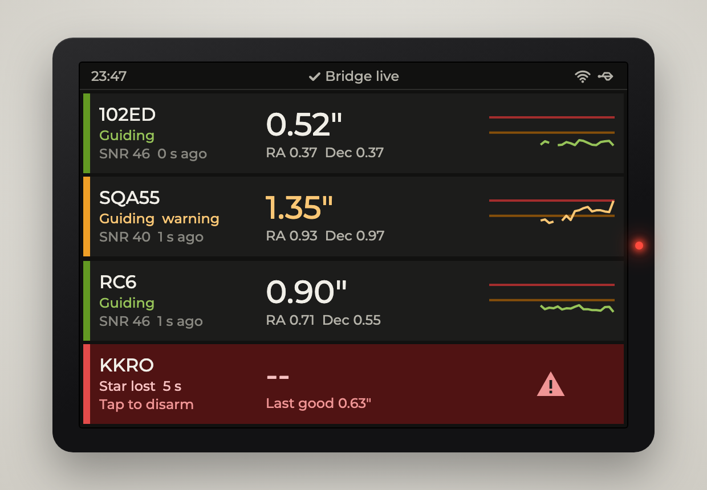
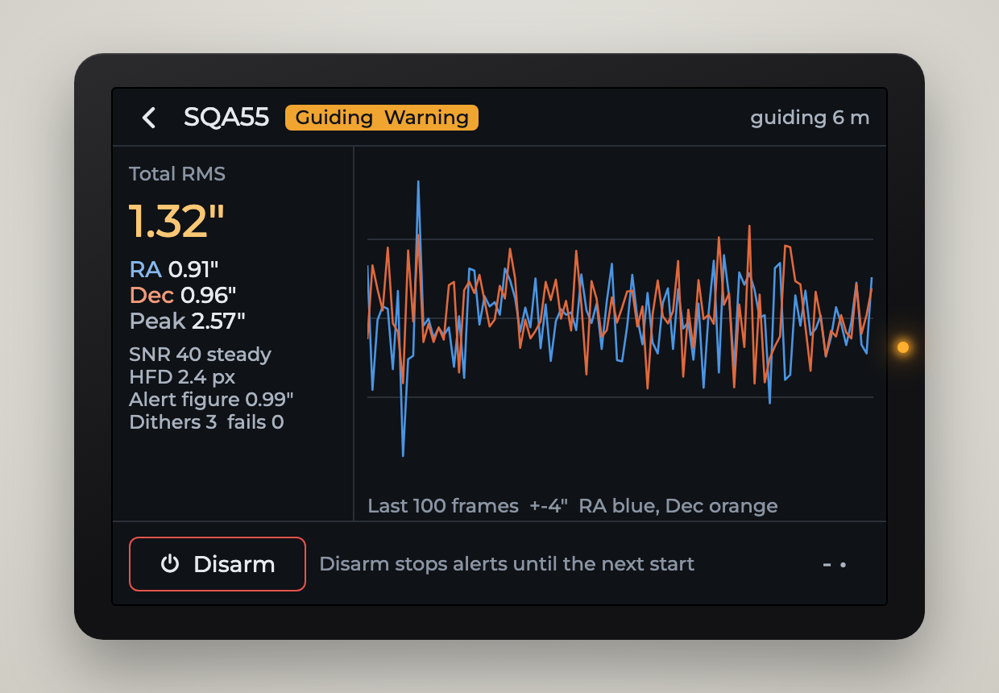
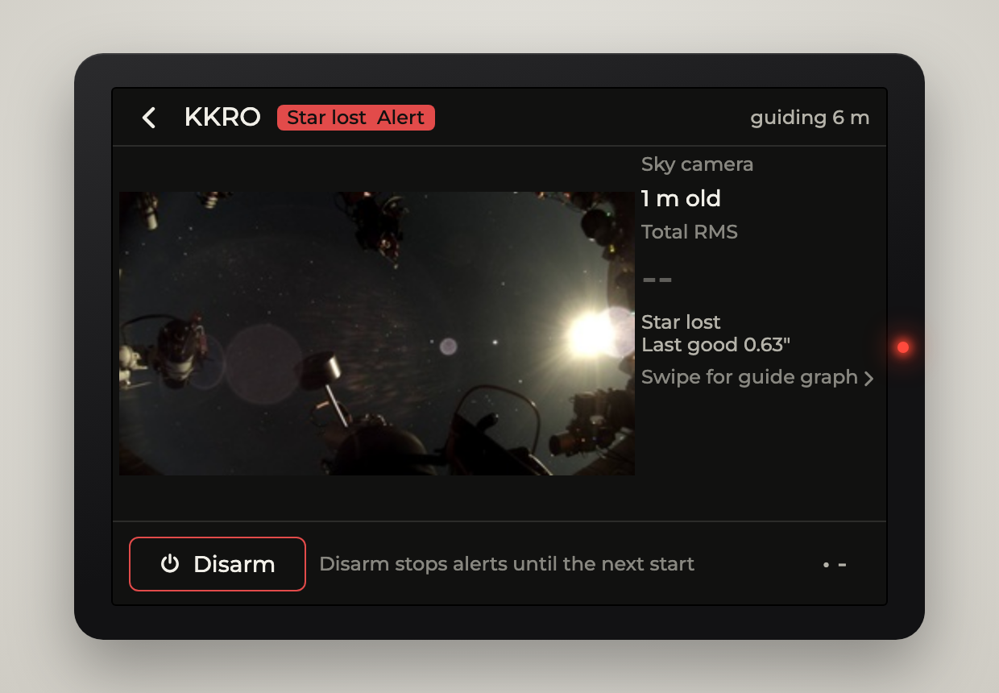

# ESP32 desk display

Firmware for a small touch-screen display that sits on your desk and shows every rig at a glance, with two LEDs that tell you when to look. It reads the monitor's MQTT messages ([mqtt-spec.md](../docs/mqtt-spec.md)); the monitor makes all the decisions.

<p>



</p>

It's written for one board, the **Guition JC3248W535**: ESP32-S3, 3.5″ 320×480 IPS screen with the AXS15231B controller and capacitive touch, 8 MB PSRAM, 16 MB flash. Other boards need their own display driver; the rest of the code (`net.cpp`, `ui.cpp`, `model.h`) is board-independent LVGL.

## What it shows

- **Overview:** one row per rig (up to 4): a level stripe, the name, what it's doing, the big total RMS (the figure your ASIAIR or PHD2 shows), RA/Dec, SNR, how long since the last guide frame, and a 10-minute trend with the warn and alert levels. On an alert the row turns red and shows the reason with a running time.
- **More rigs than rows:** with more than 4 rigs configured, it shows rigs that are imaging or need attention first, then the most recently active.
- **Rig screen** (tap a row), two pages, swipe between them:
  - **Guide graph:** the last 100 frames of RA/Dec with dithers marked, peak, HFD, the alert figure, dither and settle-fail counts.
  - **Sky camera** (rigs with `sky_image_url`): the latest all-sky picture and its age. Tap it for full screen. It opens first when an alert could be cloud.
  - **Disarm until next start / Arm now:** silences a rig you've shut down until it next starts guiding.
- **Trackers without guiding:** the frame count in place of RMS, star size and stars found, panel and time left, and a graph of star size and stars found through the run.
- **Two LEDs** (optional). Solid means look soon, flashing means look now:
  - **Guiding LED:** off when every rig is OK or idle, solid on any warning, flashing on any alert.
  - **Health LED:** flashing when an armed rig can't be seen (monitor offline, rig offline or silent, or the display's own WiFi or MQTT down for 20 s). Solid for the same faults while nothing is armed, or a low LiPo.
- **Its own checks:** no monitor heartbeat for 30 s, or a rig's data older than 30 s, turns armed rigs into alerts. A dead monitor can't report itself.
- **Screen:** off after 60 s with nothing new (tap to wake; the first tap only wakes it), on at full brightness while any rig is in alert.
- **Power saving while the screen is off:** nothing is redrawn, the CPU drops to 80 MHz and WiFi sleeps between beacons. A small (2,650 mAh) USB power bank should last over a day; this is an estimate, not yet measured.
- **Updates over WiFi** with automatic rollback if a new firmware can't get back online.

## What you need

- A Guition JC3248W535 board (search for "JC3248W535"; get the one with touch).
- Optional: two LEDs with resistors (e.g. 330 Ω) on GPIO 17 (guiding) and GPIO 18 (health) to GND. Both pins are on the board's small JST expansion connector. Set either pin to `-1` if you don't fit it.
- Power: USB-C, a USB power bank, or a LiPo on the battery connector.
- The monitor running with an `[mqtt]` section, and an MQTT broker (Mosquitto) on your network. See [Build your own display](../docs/build-a-display.md#4-a-microcontroller-over-mqtt).

## Build and flash

1. **Install** the [Arduino IDE](https://www.arduino.cc/en/software) (or arduino-cli) and the **esp32 core 3.x** (Boards Manager → "esp32 by Espressif").
2. **Install the libraries** (Library Manager):
   - **lvgl 8.4.x.** Not 9: LVGL 9 won't compile. If several versions are installed, make sure 8.x is used.
   - **PubSubClient**
   - **ArduinoJson 7.x**
   - **JPEGDEC** (Larry Bank), for the sky picture. 1.6.1 tested.
3. **Secrets:** in `esp32/arm_display/`, copy `secrets.example.h` to `secrets.h` and fill in your WiFi, the broker's address (and login if it has one), and an `OTA_PASSWORD` for updates over WiFi. `secrets.h` is ignored by git.
4. **Your rigs and settings:** create `config_local.h` next to `config.h` (also ignored by git). The rig ids must match the monitor's `config.toml`:

   ```cpp
   #pragma once
   #define RIGS_DEFINED
   static const RigConfig RIGS[] = {
       {"refractor", "Refractor"},
       {"widefield", "Widefield"},
   };
   #define TZ_INFO "GMT0BST,M3.5.0/1,M10.5.0"   // your time zone (POSIX TZ string); default UTC
   // #define TOPIC_PREFIX "arm"              // if you changed [mqtt] prefix
   // #define LED_PIN -1                      // no guiding LED
   ```

   Any `#define` in `config.h` can be overridden this way: LED pins, screen timeout, brightness, power saving, battery calibration.
5. **Board settings** (Tools menu): **ESP32S3 Dev Module**, **PSRAM: OPI PSRAM**, **Flash Size: 16MB**, **Partition Scheme: 16M Flash (3MB APP/9.9MB FATFS)** (any scheme with an app partition of 2 MB or more), **USB CDC On Boot: Enabled**.
6. **Open `arm_display/arm_display.ino`, connect the board by USB and Upload.** The first upload has to be over USB.

With arduino-cli:

```bash
arduino-cli compile --fqbn 'esp32:esp32:esp32s3:PSRAM=opi,FlashSize=16M,PartitionScheme=app3M_fat9M_16MB,CDCOnBoot=cdc' \
    --build-path esp32/build esp32/arm_display
arduino-cli upload --fqbn 'esp32:esp32:esp32s3:PSRAM=opi,FlashSize=16M,PartitionScheme=app3M_fat9M_16MB,CDCOnBoot=cdc' \
    --input-dir esp32/build -p /dev/cu.usbmodem1101 esp32/arm_display
```

Don't cut the upload short (for example by piping it into `head`): stopping it part-way can leave the board without a bootable app until you upload again.

## Updates over WiFi

After the first USB upload, later builds can go over WiFi:

```bash
esp32/ota_flash.sh esp32/build/arm_display.ino.bin            # finds arm-display.local
esp32/ota_flash.sh esp32/build/arm_display.ino.bin 192.168.1.80   # or by address
```

- Send the sketch's own `.bin` from the build folder, not the merged image. The password comes from `secrets.h`.
- If the display's screen is off it's in power saving and may not answer straight away: tap it first.
- **Rollback:** a firmware that arrives over WiFi boots on trial. If it doesn't get back onto WiFi within 3 minutes (`OTA_TRIAL_S`), or crashes first, the board goes back to the previous firmware by itself. USB remains the recovery route.

## Check it's working

The display publishes `arm/display/<DISPLAY_ID>/status` (`online`, with an `offline` last-will) and every 5 minutes `arm/display/<DISPLAY_ID>/info`, including its firmware version:

```bash
mosquitto_sub -h <broker> -t 'arm/display/#' -v
```

To test without a telescope, run the monitor against the fake rig ([development.md](../docs/development.md#without-a-telescope)) with the same rig id as on the display. Stop the monitor and the health LED should flash within about 30 s.

## Notes

- `lv_conf.h` in the sketch folder is the LVGL configuration used (found via `__has_include`). Only Montserrat 12/14/16/26/28 fonts are enabled.
- The MQTT buffer is 48 KB (for sky pictures) and sits in PSRAM, as do the decoded picture and the JPEG decoder.
- Battery percentage assumes a 1:2 divider on GPIO 5 (`BAT_DIVIDER`); check against a meter if you fit a LiPo. On a 5 V supply the status bar shows a USB symbol instead.
- Tested with arduino-cli 1.4.1, esp32 core 3.3.2, lvgl 8.4.0, PubSubClient 2.8, ArduinoJson 7.4.2 and JPEGDEC 1.6.1.
- **Licences:** the board driver files (`esp_bsp.*`, `esp_lcd_axs15231b.*`, `esp_lcd_touch.*`, `lv_port.*`, `display.h`, `bsp_err_check.h`) are Espressif's example code for this panel, Apache-2.0 (`esp_bsp.c` is CC0), with their notices kept. `lv_conf.h` is based on LVGL's template (MIT). Everything else is MIT, like the rest of this repository.
